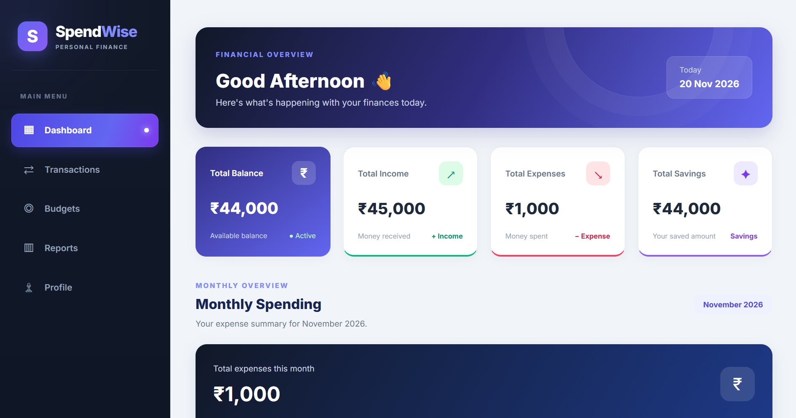

# SpendWise – Personal Finance Management System

SpendWise is a personal finance management application designed to help users track their income, expenses, budgets, and financial activities through a clean and interactive dashboard.

The application provides an organized interface for managing personal finances, viewing transaction history, monitoring budgets, and analyzing spending patterns.

## 🚀 Features

### 🔐 Authentication
- User login and registration.
- Backend-integrated authentication.
- JWT-based login session.
- Login session persistence using browser local storage.
- Secure logout functionality.

### 📊 Dashboard
- Financial overview.
- Income and expense tracking.
- Visual financial analytics.
- Recent transaction overview.

### 💳 Transaction Management
- Add and manage financial transactions.
- View transaction history.
- Search and filter transactions.
- Edit and delete transactions.

### 💰 Budget Management
- Manage personal budgets.
- Monitor spending against budget limits.
- Organize financial planning.

### 📈 Reports & Analytics
- Visual representation of financial data.
- Spending analysis.
- Interactive charts and reports.

### 👤 Profile Management
- View user profile information.
- Manage personal account details.

## 📸 Application Preview

### Dashboard



## 🛠️ Tech Stack

| Technology | Purpose |
|---|---|
| React 19 | Frontend UI Development |
| Vite 8 | Development Server and Build Tool |
| JavaScript | Application Logic |
| CSS3 | Styling and Responsive UI |
| Recharts | Data Visualization |
| Lucide React | Icons |
| ESLint | Code Quality |

## 📁 Project Structure

```text
SpendWise/
│
├── public/
│
├── src/
│   ├── assets/
│   │   └── hero.png
│   │
│   ├── components/
│   │   ├── Analytics.jsx
│   │   ├── Analytics.css
│   │   ├── Dashboard.jsx
│   │   ├── Dashboard.css
│   │   ├── Sidebar.jsx
│   │   └── Sidebar.css
│   │
│   ├── pages/
│   │   ├── DashboardPage.jsx
│   │   ├── BudgetsPage.jsx
│   │   ├── TransactionsPage.jsx
│   │   ├── ReportsPage.jsx
│   │   ├── ProfilePage.jsx
│   │   ├── LoginPage.jsx
│   │   ├── SignupPage.jsx
│   │   └── Corresponding CSS files
│   │
│   ├── App.jsx
│   ├── App.css
│   ├── index.css
│   └── main.jsx
│
├── index.html
├── package.json
├── package-lock.json
├── vite.config.js
└── README.md
```

## ⚙️ Installation and Setup

### 1. Clone the Repository

```bash
git clone https://github.com/DarillynDarsha/SpendWise.git
```

### 2. Navigate to the Project Directory

```bash
cd SpendWise
```

### 3. Install Dependencies

```bash
npm install
```

### 4. Start the Development Server

```bash
npm run dev
```

The frontend application will be available at:

```text
http://localhost:5173
```

## 🔗 Backend Integration

SpendWise frontend communicates with a separate Spring Boot backend for authentication, transaction management, and user profile operations.

**Backend Repository:**

https://github.com/DarillynDarsha/SpendWise-Backend

**Backend Local URL:**

```text
http://localhost:8080
```

Make sure the backend application and MySQL database are running when testing integrated features.

## 📦 Available Scripts

| Command | Description |
|---|---|
| `npm install` | Install project dependencies |
| `npm run dev` | Start development server |
| `npm run build` | Create production build |
| `npm run lint` | Check code quality using ESLint |
| `npm run preview` | Preview production build locally |

## 🔐 Authentication

- JWT token is received from the backend after successful login.
- The token is stored in browser local storage.
- The application checks the stored token to maintain the login session.
- Logging out clears the stored authentication information.

## 👩‍💻 Developer

**Darillyn Darsha S**  
Information Technology Student  
Aspiring Full Stack Developer

## 📌 Project Information

**Project Name:** SpendWise  
**Category:** Full Stack Web Application  
**Frontend:** React + Vite  
**Backend:** Java + Spring Boot  
**Database:** MySQL

---

⭐ If you find this project interesting, feel free to explore the repository!
